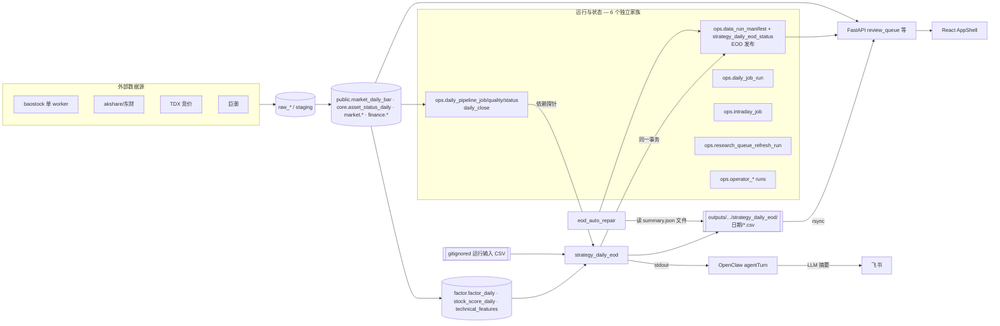

# 平台架构现状 V0.2

- 基线：`origin/main` = `9bd955621bac032ce89d43a17a2bac04aa38e262`
- 方法：只读阅读代码和 schema；小规模只读数据库统计（只读事务，`statement_timeout` 20s，只查系统视图和少量按日期过滤的行）；读取本地产物和调度记录。
- 证据标签：`SOURCE_VERIFIED`（代码中看到）、`RUNTIME_VERIFIED`（运行记录或数据库中看到）、`NOT_VERIFIED`、`INFERRED`（推断）、`DESIGN`（设计建议）。
- 本文已脱敏：不含主机地址、凭证、备份路径和通知目标。原始证据保存在内部目录。

## 0. 对此前判断的更正

| 此前说法 | 更正 | 证据 |
|---|---|---|
| EOD 没有运行表和锁（Claude，上一轮） | 错误。EOD 有 `ops.data_run_manifest`、`ops.strategy_daily_eod_status`、`commit_strategy_publication()`（manifest 和状态在同一事务提交），以及 `strategy_daily_eod_publish.flock` 非阻塞排他锁 | `strategy_daily_eod.py:75,178,482`；`data_run_manifest.py:20`；`strategy_daily_eod_store.py:12` |
| 运行状态分散在 17 张 run 表里 | 不完整。`ops` schema 共 42 个关系，其中 run/job/status 类分成**至少 6 个独立家族**（见 §3） | SOURCE_VERIFIED |
| "超跌反弹"是一条已有策略线 | `main` 上按文件名找不到（oversold/rebound/reversal/超跌 均为 0）。可能用了别的名字或在其他分支 | SOURCE_VERIFIED / NOT_VERIFIED |
| `factor_daily` 的 4 个索引是同 4 列的不同排列 | 部分准确：3 个索引是 4 列，`idx_factor_daily_lookup` 是 3 列 | `schema.py:2407-2411` |
| 可以用 `idx_scan` 判断索引是否被使用 | 现在不能用。崩溃恢复后，统计在 2026-11-01 18:56 重置，所有计数接近 0 | RUNTIME_VERIFIED |

## 1. 系统边界（脱敏）

| 组件 | 角色 | 状态 |
|---|---|---|
| 本地开发与运行主机（单台 16GB） | canonical checkout；EOD、采集、研究计算全部在这里运行 | RUNTIME_VERIFIED |
| 数据库主机 | PostgreSQL 16 生产库，约 680 GB | RUNTIME_VERIFIED |
| 展示主机 | 外部 Dashboard，docker compose 部署，直接查询生产库，并读取同步过去的产物 | SOURCE_VERIFIED（`AGENTS.md`、`deploy/`） |
| NAS | L2 逻辑备份落地 | DOCUMENT_ONLY |
| 调度 | OpenClaw（10 个股票作业，其中 7 个启用）、crontab（8 条开盘/收盘竞价采集）、launchd（5 个 agent） | RUNTIME_VERIFIED |

## 2. 能力地图

状态说明：`PROD` = 已进入每日生产路径并有运行记录；`REAL` = 用真实数据跑过；`SYN` = 只有合成数据测试；`IMPL` = 有代码；`PART` = 部分实现。

| 能力 | 主要代码 | 状态 | 可复用接口 | 重复或耦合 |
|---|---|---|---|---|
| 数据采集 | `loaders/*`、`daily_close_pipeline.py`、`minute_backfill*`、`tdx_auction_backfill.py`、`lhb_data.py` | PROD | 无统一 reader | 采集器各自维护身份转换 |
| 数据质量与就绪判定 | `daily_close_pipeline.inspect_daily_quality`、`platform_ready.py`、`data_freshness_gate.py`、`eod_auto_repair_checks.py`、`quality.py`、`dashboard/readiness.py`、`daily_health.py` | PROD（多套并存） | `ops.daily_pipeline_quality` 已持久化，但其他判定没有读它 | **同一问题有 5 套阈值**：hfq ≥5000 行、全部 ≥15000 行、≥4000 个资产、缺失率 ≤1%、精确键集合 |
| 证券身份 | `asset_identity.py`、`assets.py`、`core_data.py` | PROD | `normalize_cn_equity_asset_id` 已存在，但只有 2 个模块导入 | 15 处 `ts_code↔asset_id` 转换；40 个文件内有完全相同的 `_stock_code`；`dragon_case_library.py:4656` 把 BJ 股票错标为 SZ |
| 交易资格规则 | `tradeability.py` | REAL（P1d 审计） | `resolve_limit_rule`、`compute_pit_limit_flags` | `core_data.py:555-612` 存储的 `is_limit_up` 用固定 9.8/19.8/29.8 阈值；`lhb_data` 用 9.5，`retention_backtest` 用 9.8 |
| 日线读取 | 59 个文件里直接写 `FROM market_daily_bar` | PROD | **没有统一 reader** | 停牌状态有 3 种取法：`asset_status_daily.is_suspended`、`trade_status`、不过滤 |
| 因子与特征 | `factor_pipeline.py`、`factors/*`、`technical_features*.py` | PROD | `factor_store`、`factor_eval/*` | ATR 有 3 种定义（Wilder 平滑 / 简单均值 / min_periods=3）；最大回撤有 17 处定义 |
| 因子评价 | `factor_eval/*` | IMPL/REAL（研究用） | IC、分位收益 | 没有定时刷新，也没有 IC 的 API |
| 研究策略 | LHB、Mid Trend、Tech Bottleneck（每日发布）；另有十余个未调度模块 | PROD（3 条） | 只有 TopN 输出评分表 | 4 套回测引擎（PR #16 尚未合并） |
| 统一回测 | PR #16 `backtest_engine/` | SYN（Gate C 未完成） | `execute_target_weights` | 未进入主线 |
| 公司与产业研究 | `company_intelligence*`（CAP-01）、`chain_*`（CAP-02）、`theme_research_*` | REAL/PART | `ResearchEnvelope`、claim/证据/指纹 | 只能按主题查询，不能按股票查询 |
| CAP-03..10 | `capabilities/*` | PART（R0/R1） | envelope 契约 | — |
| Watchlist | `watchlist/*` | PROD（只读） | `/api/watchlists/{id}` | **没有写入 API**；`watchlist_item` 有两个写入方（`watchlist/store.py` 和 `operator_decision/write_service.py`） |
| 人工复核与决策 | `review_queue.py`、`operator_decision/*`、`ops.operator_*`（约 28 张） | PROD/PART | review queue 可以追溯到 `strategy_run_id` | 记录"一只股票被标记/复核/决策"的表至少有 7 处，决策词汇（defer/deferred/watch/rejected）不统一 |
| 报告与通知 | `report_delivery_*`、`feishu_notify.py`、`p5/notifications.py`、OpenClaw announce | PROD | 无 | **5 条通知路径**；EOD 通知是 OpenClaw 的 LLM 根据脚本 stdout 生成的摘要，不带 run_id |
| 任务编排与运维 | 3 套调度，加 `stock_cron_guard`、watchdog、`eod_auto_repair` | PROD | `stock_cron_guard`（交易日判定） | 见 RUNTIME 报告 |
| API 与前端 | `dashboard/app.py`（139 个路由）、`dashboard/`（React，17 个导航项） | PROD | `api/client.ts` | Strategy Lab 的验证数据来自 fixture（`strategy_validation.py:313`） |

**有多少代码是一次性研究**（INFERRED）：556 个文件中有 126 个的文件名带 pilot、_vN、rerun、closeout、batchN 等标记，约 22% 的行数；其中只有 1 个被 `cli.py` 或 `dashboard/app.py` 引用。再算上名字不带这些标记、但同样服务于单项研究的 `mid_trend_*`、`tech_bottleneck_*`、`strong_winner_*`，估计 35–45% 的代码是一次性研究，55–65% 是可复用能力。

## 3. 核心依赖与真实数据流

## 4. 结构性观察

1. **重复集中在公共基础问题上**：读日线、判定数据是否完整、判定涨跌停、解析股票身份、发通知、记录复核状态。业务逻辑本身的重复（例如各策略选股方式不同）属于领域差异，不需要合并。SOURCE_VERIFIED
2. **已有的统一实现没人用**：`asset_identity`、`tradeability`、`atomic_json`、`ops.daily_pipeline_quality`、`services/asset_status_service.is_tradable` 都已存在，但调用方很少。所以问题主要是"统一接口没有推广出去"，而不是"缺少统一接口"。SOURCE_VERIFIED / INFERRED
3. **生产代码导入研究代码和 API 层**：`strategy_daily_eod.py:25,42` 导入 `mid_trend_shadow_top10`、`tech_bottleneck_evidence_workflow`；`strategy_eod_publish.py:14-16,1218` 导入 `dashboard.*`；`strategy_eod_publish.py:2101` 和 `strategy_daily_eod` 互相导入。SOURCE_VERIFIED

## 5. 不需要改的部分

PostgreSQL 主库；Python；React AppShell 作为唯一前端；单体包结构；`tradeability.py`；raw payload 只追加；`asset_id` 带市场前缀的格式；CAP-01 的证据和指纹；`commit_strategy_publication` 的事务提交；各策略的内部实现。
