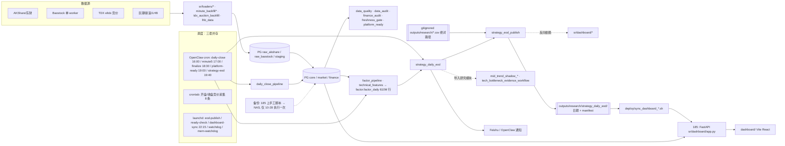

# 股票研究平台架构、功能与演进路线独立审查（2026Q4）

- 审查基线：`origin/main` = `9bd955621bac032ce89d43a17a2bac04aa38e262`
- 只读参考：`fix/r3-m2-prelaunch-safety` = `1636b1fd`（M1/M2 代码与存储报告），其余 DATA-R3 分支
- 运行证据：canonical 工作区 `logs/cron/`、`outputs/research/strategy_daily_eod/`、`~/.openclaw/cron/jobs.json.migrated`、`crontab -l`、`launchctl list`（2026-10-31 读取）
- 本轮未连接任何数据库，未运行回测，未修改 canonical 工作区

证据标签：`CODE_VERIFIED`（代码中看到）、`RUNTIME_VERIFIED`（日志/产物中看到）、`DOCUMENT_ONLY`（只有文档）、`NOT_VERIFIED`、`ARCHITECTURAL_JUDGMENT`（判断）。路径中 `sr/` = `src/stock_research/`。

---

## 1. 执行摘要：最重要的五个发现

**F1. 策略结论的最大风险来自回测方法，不来自数据层。** `CODE_VERIFIED`
四个策略用四套独立回测引擎，成交时点、成本、交易约束各不相同：

| | Tech Bottleneck | Mid Trend | TopN | LHB |
|---|---|---|---|---|
| 引擎 | `serenity_tight3b_c2_experiment._simulate_one_config` | `market_style_switch_v1._simulate_equal_weight_daily` | `vectorized_topn_backtest` | 自有事件账户 |
| 成交时点 | 信号日 T 收盘（:349-423） | 信号日 T 收盘（:619-620） | T+1 收盘（:277-299） | 次一交易日 |
| 成本 | 统一 20bp×换手 | **0** | 默认 **0**（`backtest_constraints.py:9-11`） | 默认 0 |
| 涨跌停/停牌阻断 | **无**（`tech_bottleneck_v1.py:476-486`） | **无**（`current_mid_trend_strategy_v1.py:163-169`） | 有 | 仅 ST 过滤 |
| 样本外 | 无，同窗口调参与评估 | 研究脚本有 train_end，生产参数来源不明 | 有 holdout 工具，覆盖面 NOT_VERIFIED | 有校准 |
| 基准 | 无 | 无 | 无 | 仅与旧版对比 |

另外，Tech Bottleneck 的 153 只股票池是 2026 年用 2025-01-01～2026-06-05 数据事后选出的（`tech_bottleneck_v1.py:29-33`），回测又在同一窗口评估。这是主题选择偏差加幸存者偏差。`ARCHITECTURAL_JUDGMENT`：这些偏差对收益的影响，很可能比 DATA-R3 修正的 84,844 个交易状态差异大一个量级。目前没有任何实验量化过这两类影响。

**F2. DATA-R3 做了大量工作，但几乎没有接入策略。** `CODE_VERIFIED`
- `qualification_mode`（legacy / corrected_shadow / verified_v2）只出现在 `sr/vectorized_topn_backtest.py` 一个文件里。
- `sr/financial_pit.py`（D+1 规则）在 `src/` 中没有消费者。Mid Trend 仍按 `announcement_date > trade_date` 判断前视（`sr/midtrend_pit_fundamental_features.py:138`），即公告当天就算可用。
- Tech Bottleneck 发布时把 `financial_as_of_date` 改写为 `first_hit_date`（`sr/strategy_eod_publish.py:546-549`），不是真实的披露日期。
- M1 的 `eod_v2_writer.py`、`financial_version_store.py`、`data_integrity_gate.py` 不在 `main` 中。

`docs/research_upgrade` 在 `1636b1fd` 上有约 75.6 万行文档，是全部 Python 源码（约 24.8 万行）的 3 倍。10-20 以来，涉及 `docs/research_upgrade` 的提交有 28 个，涉及 Tech Bottleneck、Mid Trend、回测代码的提交只有 5 个。

**F3. 已经产生实际成本的是运行环境和可复现性，不是架构抽象。** `RUNTIME_VERIFIED`
- 10-30 那次 EOD，4 个策略全部报 `ImportError: tabulate` 失败。`pyproject.toml` 没有声明 tabulate，但 `src/` 中有 90 个文件调用 `to_markdown`，而且仓库没有根锁文件。
- 10-30 23:00 的重试和 10-31（星期六，非交易日）20:30 的触发都直接报 `.venv/bin/python: No such file`。确认失败的交易日是 10-30 一个；10-31 是非交易日的运行尝试。
- GitHub Backend CI 导入 `cli.py` 时报 `ModuleNotFoundError: tushare`：`sr/auction_data.py:9` 仍有 `import tushare as ts`，而 `pyproject.toml` 没有声明它（PR #15 CI 日志）。项目已决定不依赖 Tushare，应移除这个遗留导入，而不是安装 Tushare。
- 调度分散在三个系统：crontab 8 条（竞价采集）、OpenClaw cron 9 条启用的股票作业（daily-close、platform-ready、strategy-eod 等）、launchd 5 个 agent。
- 运行时输入依赖 gitignored 的 CSV，并且写成绝对路径（10-17 事故，见 `AGENTS.md`）。
- Tech Bottleneck 回测读取"最新 mtime"的快照文件（`sr/tech_bottleneck_v1.py:321-331`），所以无法复现。

**F4. 存储的根本问题是 `factor.factor_daily` 的数据模型，不是索引膨胀。** `DOCUMENT_ONLY`（数字来自 `1636b1fd` 报告）
- 这张表 610.7M 行，是窄长表（每行一个资产、一天、一个因子的值）。4 个索引覆盖同一组 4 列，只是列顺序不同，合计 169GB，是 75GB 表数据的 2.25 倍。
- 约 57GB 索引膨胀的估计证据较强。约 161–170GB"整体膨胀"只是目录大小差额，只能当作上限（见 §4.5）。
- 继续 REINDEX 只能回收一次性的膨胀。真正能持续解决问题的是：历史因子转为列式存储，在线库只保留近期数据。
- 备份目前只做过一次手工执行（10-28），没有调度，`archive_mode=off`，没有 PITR。

**F5. M2 应该大幅收缩，先做 M3-lite，再决定迁移什么。** `ARCHITECTURAL_JUDGMENT`
- 保留：`tradeability.py` 规则引擎、D+1 规则（改造为按决策时点判断）、raw payload 只追加存储。
- 暂停：M2-T 的 T1–T5（往 1730 万行表上 ALTER 加列再回填）；M2-F 的 finver 三表事件链暂停，待精简设计（§4.4）确认后再决定是否取消。
- 取消：多层 Gate JSON 和每个子步骤的审批矩阵。
- 先做统一执行层 POC（§5.3a），确认引擎可用后跑 M3-lite（§5.3）。
- 研究正确性与生产迁移分开判断：已确认的前视和错误标签，在研究层一律修正，不因收益差异小而接受；M3-lite 只用来决定哪些修正值得投入生产数据库的物理迁移成本。

---

## 2. 现有系统架构（按代码还原）

### 2.1 R1 架构问题分级

| 问题 | 证据 | 已产生成本？ | 建议 |
|---|---|---|---|
| 依赖未声明、无锁文件、venv 可被误删 | `pyproject.toml` 10 个依赖仅 eltdx 固定版本；tabulate 未声明；`auction_data.py:9` 遗留 `import tushare` 使 CI 失败；EOD 10-30 失败，10-31 运行尝试失败 | **是，10-30 交易日 EOD 未发布** `RUNTIME_VERIFIED` | 立即处理：`uv lock` 或 `pip-compile` 生成锁文件，wrapper 启动前自检 |
| 调度分散在三套系统 | OpenClaw 9 条 + crontab 8 条 + launchd 5 个 | **是**：stdout 心跳契约、watchdog 误杀；10-30 交易日 EOD 失败后，直到 10-31 才被人工发现 | 统一到一套调度和一个 `run_job` 入口，加"距离上次成功超过 N 小时"告警 |
| 四套回测引擎，口径不同 | 见 F1 | **是**：策略收益无法互相比较，DATA-R3 修正接不进去 | 建一个统一执行层。`vectorized_topn_backtest` 的约束和成本模块可以作为起点，但它目前不接受外部目标权重、不支持开盘价成交（§5.3a），需要先做 POC |
| 运行时依赖 gitignored CSV，写成绝对路径 | `sr/tech_bottleneck_v1.py:29-38`；`AGENTS.md` 10-17 事故 | **是** | 把这些输入登记成带 sha256 的"研究资产"，从 manifest 读路径 |
| 生产 EOD 导入研究模块和 dashboard 模块 | `sr/strategy_daily_eod.py:25,42`；`sr/strategy_eod_publish.py:14-16,1218,2101` | 部分：研究代码的修改会影响生产，且存在循环导入 | 抽出 `production/` 包，只允许它依赖 core 和 strategy 两层 |
| 交易资格规则有多处重复实现 | `sr/tradeability.py` 与 `sr/dragon_case_library.py:795,1460`、`sr/lhb_data.py:8713` | 潜在：不同策略对"能否成交"的判断不一致 | 统一调用 `tradeability` |
| 同一策略留了大量版本副本 | `tech_bottleneck_quality_pool_layer*` 约 10 个文件；约 60 个 `tech_bottleneck_*`；`mid_trend_*` 和 `midtrend_*` 两种拼写 | 维护和定位成本 | 合并为一个参数化模块，旧版本放进 `research/archive/` |
| `cli.py` 10,553 行、343 个子命令；`lhb_data.py` 11,401 行 | `CODE_VERIFIED` | 低 | **暂不处理**，属于理论缺陷 |
| 93 个源文件含 `/Users/xiwei` 绝对路径 | `CODE_VERIFIED` | 单机场景下低 | 暂不处理；新代码禁止新增 |
| 7 个数据质量模块职责重叠 | `data_quality / quality / data_audit / ...` | 低 | 暂不处理 |
| 单体应用 | — | — | **保留单体**，只加强包边界，不拆服务 |

`ARCHITECTURAL_JUDGMENT`：这个平台的问题不是过度抽象，而是合并不足（新需求靠复制出新版本文件来解决）和流程过重（gate、审批、文档）。代码层面的抽象反而偏少，例如没有统一的"策略输出目标权重"接口。

### 2.2 数据分层与来源追踪

- 分层是存在的：raw 层到 core/market/finance 层，再到 factor 层，最后是产物层。`CODE_VERIFIED`
- raw payload 层是追加写入的（`raw_akshare.finance_payload`），这本身就是一份可用的供应商版本日志。
- 缺的是"一次研究或回测具体读了哪份数据"的标识。Tech Bottleneck 回测读最新 mtime 的文件，每天的产物也不带数据快照 id。所以可复现性的缺口在消费端，不在存储端。

---

## 3. 核心功能成熟度与缺口（R2）

定位：单人或少数研究者使用的 A 股研究平台。按工作流顺序评估：发现主题 → 收集证据 → 构建股票池 → 构建因子 → 回测验证 → 观察信号 → 决策复盘 → 迭代策略。

状态的判定标准：
- **完整**：已接入生产路径，并且有测试或运行证据。
- **部分**：有实现但没有接入生产，或者接入了但缺少关键部分。
- **原型**：只有一次性的模块或脚本，没有调度。
- **仅设计**：只有文档。
- **缺失**：没有找到。

| # | 能力 | 状态 | 证据 | 对研究质量的价值 |
|---|---|---|---|---|
| 1 | 股票池与 Watchlist | 完整 | `sr/watchlist/`、`/api/watchlists`、`test_dashboard_watchlist.py`；每日产物 `watchlist_report_2026-10-30_*` `RUNTIME_VERIFIED` | 高 |
| 2 | 科技产业链与主题研究 | 部分 | TB 候选在 EOD 中产出；约 70 个 `tech_bottleneck_*` 是一次性批处理、重跑或 gate 脚本；`theme_research_*` 和 `company_intelligence*` 有 DB、API 和测试；CAP 注册表有 21 项 | 高，但重复实现严重 |
| 3 | 财务与基本面 | 部分 | `services/finance_ttm`、`fundamental_pipeline`、`financial_pit`（没有消费者）；未接入 EOD | 高 |
| 4 | 个股画像 | 完整 | `dashboard/asset_profile*.py`、12 个 `/api/assets/*` 路由、测试 | 高 |
| 5 | 因子研究与 IC | 部分 | `factor_eval/`（IC、分位收益、gate、多周期）和 9 个测试；IC 没有定时刷新，也没有 API 或页面展示 IC | 高 |
| 6 | 回测可信度与对照实验 | 部分，**最大缺口** | 只有 TopN 支持 `qualification_mode`，而且测试没有覆盖它；没有通用的 A/B 框架；四套引擎口径不一致（§1 F1） | **最高** |
| 7 | 策略参数管理 | 部分，较弱 | `config/` 下只有 3 个 CSV；参数写在模块常量和 `_v1`/`_v2` 文件名里 | 高 |
| 8 | 信号与持仓解释 | 部分 | EOD 中 `strategy_score_audit` 写出明细；`/api/strategy-score-audit` | 高 |
| 9 | 研究结论复现 | 部分 | `data_run_manifest.code_version` 实际填的是 `source_kind`，不是 git SHA（`sr/strategy_eod_publish.py:811`）；没有数据快照 id；Mid Trend 读取一个冻结在 2026-06-12 的候选目录，而且路径写死（`sr/strategy_daily_eod.py:1340`） | 高，修复成本低 |
| 10 | 策略间比较 | 部分 | 有运行列表和 `StrategyCohortPanel`；没有统一的指标引擎。口径不一致，所以比较结果不可信 | 中 |
| 11 | 历史信号回放 | 部分 | `/api/.../replay` 只回放已存储的结果，不能按时点重新计算 | 中 |
| 12 | Dashboard | 完整，偏重 | 139 个路由、约 45 个工作区组件，其中 shadow 类面板 8 个，另有鉴权和管理后台 | 中；对单人使用来说过度建设 |
| 13 | 每日自动研究报告 | 部分 | `run-daily-review-v1` 在 EOD 之后运行，失败不影响 EOD；没有找到它的产物目录 | 高，前提是能稳定运行 |
| 14 | ETF 资金流与市场状态 | 部分；ETF 资金流缺失 | `market_emotion_state` 每日在 finalize 阶段计算；`market_regime_confirmation_v1` 只是一个回测产物，TB 读它时用最后一行前向填充；`main` 中没有 ETF 资金流代码（只存在于 `research/etf-flow-*` 分支） | 中 |
| 15 | AI 辅助与知识检索 | 原型 | 18 个 `data_to_brief_docling_*` 试点；没有 LLM 或向量检索客户端；`/api/search` 只做关键词搜索 | 现在低，长期高 |
| 16 | 决策复盘 | 部分到完整 | review queue、证据快照、shadow outcome、`operator_decision_outcome` 测试 | 高 |

每日实际发布的策略（`RUNTIME_VERIFIED`，以 10-29 产物为准）有四项：`lhb_shortline`、`mid_trend`、`tech_bottleneck`、`midtrend_artifacts`。另有十余个策略模块存在但没有调度，包括 `current_mid_trend_strategy_v2_top10_candidate`、`market_style_switch_v1`、`industry_regime_gated_backtest`、`dragon_strategy_research`、`strong_winner_*`，以及约 40 个 `mid_trend` 实验模块。

**价值判断**（`ARCHITECTURAL_JUDGMENT`）：
- **能直接提高决策质量的**：#6 统一对照实验、#9 复现性（代码 SHA 加数据快照）、#7 参数外置、#5 IC 定期刷新和展示、#13 每日报告稳定运行。这些都是已有能力的补全和打通，成本低。
- **工程上看起来先进、但当前价值低的**：
  - TB 的 quality_pool 从 v1 到 v7，以及约 70 个批处理脚本
  - 18 个 docling 试点
  - 8 个 shadow 面板和单人场景下的鉴权、管理后台
  - M2-F 事件版本链
  - CAP 能力注册表的扩展

---

## 4. 数据架构演进建议（R3）

### 4.1 三个方案比较

| | A. 继续演进纯 PostgreSQL | B. PG + Parquet/DuckDB 混合（推荐） | C. 换 Qlib bin / ClickHouse / TimescaleDB |
|---|---|---|---|
| 解决的问题 | 一致性与在线查询 | 历史回测的扫描性能与存储；在线库瘦身 | 同 B，另带生态 |
| 187 磁盘 | 持续增长；REINDEX 每次需约 65GB 临时空间 | 冷数据移出后在线库可以变小，但实际回收量要由 POC 测出（§4.2），不预先承诺 | 需要新组件和新磁盘 |
| 改造量 | 低 | 中：只改历史读取路径（回测、因子评价） | 高：重写数据加载和消费者 |
| 运维 | 已熟悉 | DuckDB 是一个嵌入式库，没有服务进程 | 多一个服务，或换一种数据格式 |
| 结论 | 只作为在线层 | **采纳** | 不采纳；只借鉴 Qlib 的 PIT 设计 |

### 4.2 数据放置

- **必须留在 PG**：
  - 资产主数据和交易日历
  - `core.asset_status_daily`
  - 日线 `market_daily_bar`（约 23GB）
  - 财务三表和 raw payload
  - 近 1–2 年的因子
  - research、review、watchlist 等交互数据
  - 每日 EOD 的写入
- **移到 Parquet**（按 年/月 分区，zstd 压缩，NAS 上保留双副本）：
  - `market.stock_minute_bar` 中 2020–2024 年冻结的分区。仓库报告估计 135GB 以上，压缩后 15–25GB（`DOCUMENT_ONLY`：`DUCKDB_PARQUET_FEASIBILITY.md`），这些数字都未经实测
  - `factor.factor_daily` 中两年以前的历史，改成宽表格式：每行是一个资产×日期，每个因子一列
  - `label_snapshot` / `feature_snapshot` 中的历史部分
- **在线查询和历史回测应使用不同的存储层**：
  - Dashboard 点查走 PG。
  - 回测和因子评价走 DuckDB 读 Parquet。
  - 回测输入固定为某个 Parquet 快照目录。快照目录名本身就是数据版本号，这顺带解决了 F3 中的可复现问题。

**迁移前必须先做 POC，不预先承诺释放空间。** 原因：
- 用 `DELETE` 删除 PG 行不会让数据文件变小，空间只会被表内复用；要真正归还给文件系统，需要 `DETACH PARTITION` 后 `DROP` 整个分区，或者对表做重写（`VACUUM FULL` / `pg_repack`，重写期间需要约等于表大小的额外空间）。
- `stock_minute_bar` 是按 `trade_date` 范围分区的表（`sr/schema.py:27`），可以整分区删除，回收路径相对干净。`factor.factor_daily` 不是分区表（`sr/schema.py:1920`），删除历史行之后必须重写整表或重建为分区表，过程中需要额外空间，在 20.5GB 余量下做不了。
- 导出过程本身也要空间：导出文件应直接写到 185 或 NAS，不能落在 187 上。

POC 验收标准（全部满足才进入正式迁移）：

| 项 | 验收 |
|---|---|
| 范围 | 在 185 恢复实例上，选 `stock_minute_bar` 的一个年度分区（例如 2020 年） |
| 导出一致性 | PG 与 Parquet 两边的行数一致；按 (asset_id, trade_date) 分组的行数和 OHLCV 合计逐组一致；再随机抽 1000 个键逐行比较 |
| 双向校验 | Parquet 再导回一张临时 PG 表，与原分区做 `EXCEPT` 双向比较，两个方向都为 0 行 |
| 实际空间回收 | 在恢复实例上执行 `DETACH` + `DROP`，记录 `pg_database_size` 和 `df` 的前后变化；报告"实测释放量 / 分区原大小" |
| 恢复能力 | 删除后从 Parquet 和从 L2 dump 各恢复一次该分区，计时并核对校验和 |
| 查询 | 回测、因子评价的代表查询分别在 PG 和 DuckDB 上运行，结果一致，耗时对比 |
| 消费方改造量 | 列出所有读取该表的代码路径和需要修改的地方 |

只有 POC 给出实测的释放比例和耗时后，才估算全量迁移能释放多少空间。`factor_daily` 的迁移要单独设计，放在分钟线之后。

### 4.3 编排

不建议现在引入 Prefect 或 Dagster。现阶段的问题是三套调度并存、失败没人发现、依赖不固定，这些都不是 DAG 能力不够造成的。

建议做法：
- 收敛到一套调度（OpenClaw 或 launchd 二选一）。
- 用一个 `scripts/run_job.sh` 统一做环境自检、心跳、退出码记录和"距离上次成功的时间"告警。

等作业之间的依赖关系超过约 20 个节点、并且确实需要回补历史时，再评估 Dagster，它的 asset 概念和本项目"数据产物"的思路吻合。`ARCHITECTURAL_JUDGMENT`

### 4.4 财务 PIT：先简化，事件链暂停而不是立即取消

**研究上真正需要的是**：对每个 (asset, report_period, field)，知道"信号形成时点 t，市场上能看到的是哪个值"。这里有三个不同的时间，必须分开：

| 时间 | 含义 | 来源 |
|---|---|---|
| `announce_ts` / `announce_date` | 市场首次能看到这份报告（或更正公告）的时刻 | 巨潮公告时间、`finance.*.announcement_date` |
| `vendor_seen_at` | 平台第一次从供应商抓到这个值的时刻 | `raw_akshare.finance_payload.fetched_at`（`sr/schema.py:947-955`） |
| `signal_ts` | 信号形成时点，统一取 T 日 15:00 收盘后 | 执行口径（§5.2） |

规则：一个值只有在 `known_at <= signal_ts` 时才能用于 T 日信号、T+1 执行。`known_at` 由公告时间推出，而不是由抓取时间推出（抓取时间只对 2026 年以后的增量有意义）。

**现有数据能提供什么**：

| 信息 | 现状 | 证据 |
|---|---|---|
| 公告日期 | 有，日级 | `finance.*.announcement_date` |
| 公告时刻（盘前或盘后） | 代码已能从巨潮拿到 `announcementTime`（毫秒时间戳），但只在一个采集脚本里用到 | `sr/tech_bottleneck_remaining_primary_source_collection.py:146` `CODE_VERIFIED` |
| 首次披露值和更正值 | 东财只保留最新公告日期，首次披露日期丢失 | `sr/financial_pit.py` 的 `REANNOUNCE_LAG_DAYS=240` 注释 `CODE_VERIFIED` |
| 平台观察到的版本 | raw payload 只追加，带 `fetched_at` 和 `payload_hash`；P2.1 识别出 34 个有实质变化的版本分组 | 表结构 `CODE_VERIFIED`；版本分组 `DOCUMENT_ONLY` |

由此得出以下判断：

1. **历史修订值本身就是一种前视，不能默认可接受。** 供应商当前给出的值，可能是事后更正过的值。如果某期报表在 D2 被更正，而回测在 D1～D2 之间用了更正后的值，这就是未来函数，无论它对收益影响多大。所以：
   - 有初版证据的期次（初版公告 PDF、或 2026 年以后 raw payload 中较早的抓取记录），D1～D2 期间必须用初版值。
   - 没有初版证据、但识别出发生过更正的期次（`is_restated=true`），在研究层**排除该期次在更正前的使用**，或者整体标记为 `UNKNOWN` 并在 M3 中单独统计；不能静默使用最新值。
   - 没有任何更正迹象的期次，才使用供应商当前值，并标为 `INFERRED`（不是 `VERIFIED`）。

2. **raw payload 需要可验证的版本时点。** `fetched_at` 有默认值 `now()`，但目前没有防止事后修改或补写的约束。至少需要：
   - 写入后只追加，不允许 UPDATE（权限或触发器）；
   - `payload_hash` 加 `fetched_at` 一起进入每次 L2 备份，用备份代际作为外部见证；
   - 历史回补（例如批量重抓旧数据）必须写明"回补"标记，不能把回补的 `fetched_at` 当作当时就看到。

3. **finver 事件链：暂停，待精简设计确认后再决定取消。** `financial_version_store.py` 的文件说明写明了 `first_seen_at` 只是平台观察时间，所以它补不回 2026 年以前的历史 PIT（`CODE_VERIFIED`）。它的 A→B→A 和乱序处理，解决的正是上面第 2 点"平台观察到的版本序列"问题。在确认以下精简方案能覆盖同样的需求之前，不删除这部分设计：
   - 精简方案：raw payload 只追加 + 一张由它派生的 `finance.statement_vintage(asset_id, report_period, statement_type, source, field_hash, first_seen_at, last_seen_at, seen_count)` 表，可从 raw 重建，不需要 advisory lock。
   - 判断标准：精简方案能否在测试实例上复现 finver 现有测试中的 A→B→A、乱序到达、重复观察这三类用例。能复现就取消 finver，不能就只保留缺的那一部分。

4. **推荐的消费模型**：一个视图或物化表 `finance.statement_pit`。
   - 主键：`asset_id, report_period, statement_type, source, vintage`
   - 字段：`announce_date`、`announce_ts`（可空）、`known_at`、`vintage`（`initial` / `restated` / `vendor_current`）、`evidence_level`（`VERIFIED` / `INFERRED` / `UNKNOWN`）
   - `known_at` 的规则：
     - `announce_ts` 存在且早于 09:30：当天开盘前可用，`known_at = D 09:30`。
     - 盘中或收盘后发布：`known_at = 发布时刻`；对 T 日收盘信号而言，T 日 15:00 前发布的可用于 T 日信号，15:00 后发布的只能用于 T+1 日信号。
     - 只有日期没有时刻：一律按 D+1 开盘前可用（`known_at = 下一交易日 09:30`），这是保守口径。
     - 日期为哨兵值 1900-01-01：不可用。
   - 消费端只能通过 `known_at <= signal_ts` 读取，这个判断只写在一个函数里。
   - `NOT_VERIFIED`：巨潮公告时刻对历史财报的覆盖率还没有统计。覆盖率低时，实际上就退化为 D+1。

5. **不能只靠 D+1 解决 PIT 的还有三点**：
   - 业绩预告和快报比正式报表早，而 Tech Bottleneck 和 Mid Trend 的财务状态是否用到预告，`NOT_VERIFIED`。
   - 供应商的 `UPDATE_DATE` 可能晚于公告日期，抓取快照可能比真实可用时间更保守，也可能更激进。
   - 年报和一季报在同一天披露时，要按 `report_period` 取最新，而且两份报告都必须满足 `known_at` 条件（`financial_pit.py` 已经实现了这种两级选择，`CODE_VERIFIED`）。

### 4.5 存储优化建议的证据质量

| 论断 | 证据 | 评级 |
|---|---|---|
| factor_daily 索引可回收约 57GB | 在恢复实例上用相同定义新建，与生产按索引逐个对比字节数（`INDEX_BLOAT_AND_OVERLAP.csv`） | **较强**：方法对。但恢复实例是全新构建（叶子页填充约 90%），而生产索引在日常写入下迟早会回到约 70–80% 的密度，所以实际可持续节省会低于 57GB |
| 整体膨胀约 161–170GB | 生产目录约 688GB 减恢复实例约 518GB | **弱，只能当上限**：没有跑过 `pgstattuple`。差额还混入了 FSM/VM、TOAST、pg_wal、统计信息，以及恢复时 `wal_level=minimal` 和 autovacuum off 带来的差异。不能用这个数字来规划回收量 |
| REINDEX 单个大索引需约 65GB 临时空间、约 30GB WAL | 恢复实例上实测 | **较强**；生产 IO 条件更差，耗时可能更长 |
| 宿主约 186GB 非 pgdata 空间 | df 和 du 差额，containerd 线索 | **弱**：宿主机本身没看到。管理员只读盘点是唯一能确认的办法 |
| 低扫描次数的索引可以删掉 | — | 报告本身已否定，结论正确 |

**建议**：
- 存储治理先做两件事：宿主机盘点、扩容决策（在 187 上增加一块盘是最便宜、最快的根治办法）。
- 第二步，做分钟线单分区 Parquet POC（§4.2），按实测结果再决定全量迁移；`factor_daily` 放在其后单独设计。
- REINDEX 留作有余量之后的可选项，不作为主线。

---

## 5. 策略研究可信度评价（R4）

### 5.1 按偏差影响排序

| 排名 | 偏差 | 影响的策略 | 证据 | 预期方向 |
|---|---|---|---|---|
| 1 | **事后选股池**：153 只股票由 2026 年的结果选定，用来回测 2025–2026 | TB | `sr/tech_bottleneck_v1.py:29-33`；CSV 中含 `period_return`、`return_250d` | 收益严重高估 |
| 2 | **同一窗口调参又评估**，没有样本外检验 | TB；MT 存疑 | `tech_bottleneck_v1.py:26-28` | 高估 |
| 3 | **按信号日收盘成交** | TB、MT | 见 F1 | 动量类策略高估，A 股涨停次日溢价尤其明显 |
| 4 | **零成本或成本偏低** | MT、TopN、LHB | `backtest_constraints.py:9-11` | 高换手策略高估，A 股双边约 0.15–0.3% |
| 5 | **涨停买不进、跌停卖不出没有阻断** | TB、MT | `tech_bottleneck_v1.py:476-486` | 追强势股的策略高估 |
| 6 | 市场状态序列用最后一行前向填充 | TB | `tech_bottleneck_v1.py:445-455` | 2026-06 以后的仓位信号失真 |
| 7 | 财务数据当天可用 | MT、TB | `midtrend_pit_fundamental_features.py:138`；`strategy_eod_publish.py:546-549` | 小幅高估，只在财报季附近 |
| 8 | 历史交易状态标签错误（P1d 的 62,937 个确认错误） | 只影响 TopN 的 legacy 模式 | `vectorized_topn_backtest.py:227-228` | 未知，大概率很小 |
| 9 | 没有基准，没有分年或分市场状态的拆分 | TB、TopN | grep 结果 | 无法判断超额收益 |

`ARCHITECTURAL_JUDGMENT`：DATA-R3 修的主要是第 7、8 项，排第 1–5 位的问题至今没有处理。

### 5.2 统一研究标准（三个策略都应遵守）

1. 信号在 T 日收盘形成，在 T+1 开盘价成交。没有开盘价的，用 T+1 的 VWAP 或收盘价作为保守替代。
2. 成本：佣金 2.5bp 双边；印花税卖出 5bp（2023-08-28 以前为 10bp）；滑点 10bp。另跑一组成本翻倍的敏感性测试。
3. T+1 买入时涨停不能买，跌停不能卖，停牌不能交易，统一用 `tradeability.py` 判断。
4. 股票池要用 T 日之前就能知道的规则生成。事后选出的名单只能当作"上限参照"，不能当作策略收益。
5. 至少保留一段样本外区间。目前可用的准样本外区间是 2026-06-08 至 2026-10-27，并且要逐年拆分结果。
6. 基准：中证 1000、中证全指等权，以及同主题的等权股票池。
7. 每次运行写入 `run_manifest.json`，记录代码 SHA、数据快照 id、参数哈希和输入文件 sha256。

### 5.3a 统一执行层 POC（M3-lite 的前提）

上一版说"复用 `run_vectorized_topn_backtest`"。复核代码后，这个说法不准确：它的约束和成本模块可以复用，但执行模型本身不能直接用于 T+1 开盘成交和外部目标权重。核对结果（`CODE_VERIFIED`，`sr/vectorized_topn_backtest.py` @ `9bd95562`）：

| 能力 | 现状 | 证据 | 可否直接复用 |
|---|---|---|---|
| 信号日与执行日分离 | 有：`signal_date = trading_dates[i-1]`，`execution_date = trading_dates[i]` | :277-278 | 是 |
| 成交价 | 只有收盘价收益：`_close_to_close_returns` 用 `close.pct_change()`；持仓从执行日收盘开始计收益，等效于**执行日收盘成交**。`open` 列被读入，但不参与收益计算 | :262, :544-553, :380 | **否**，T+1 开盘成交需要新写 |
| 外部目标权重输入 | 没有：目标权重只由 `scores` 的 `rank` 取前 N、等权生成 | :607-639 | **否**，需要新增 `target_weights` 输入 |
| 权重漂移 | 没有：持仓权重每日保持目标值不变，相当于每天隐式再平衡到等权 | :380, :865-880 | **否**，需要按价格漂移 |
| 涨停买入、跌停卖出、停牌阻断 | 有：在执行日的 bar 上调用 `can_open_long` / `can_close_long` | :739；`backtest_constraints.py:30-` | 是 |
| 卖出受阻后重试 | 有：`_retry_pending_sell_orders` | :786 | 是 |
| 买入受阻后的处理 | 未见重试，受阻买单直接放弃（`NOT_VERIFIED`，需要读完 :652-785） | — | 需确认 |
| 成本模型 | 有：佣金、滑点、卖出印花税三项，按单边费率计 | `backtest_constraints.py:76-80` | 部分：印花税是固定值，不随 2023-08-28 税率调整变化 |
| 交易资格修正 | 有：`qualification_mode="corrected_shadow"` | :209-213 | 是；但 `tests/test_vectorized_topn_backtest.py` 中没有覆盖它的测试（grep 为 0） |
| 每周调仓 | 有 | :566-567 | 是 |

**POC 范围**（在独立研究环境中做，生产 EOD 保持原有行为）：
1. 新写一个执行函数 `execute_target_weights(target_weights, prices, constraints, fill="next_open"|"next_close")`，复用 `can_open_long` / `can_close_long` / `one_way_cost_rate` / 卖出重试逻辑。
2. 收益按"执行价 → 当日收盘 → 之后每日收盘"计算，权重随价格漂移。
3. 印花税按日期取值。
4. 用 TopN 做兼容性验证：在 `fill="next_close"`、权重不漂移的设置下，新函数必须和原 `run_vectorized_topn_backtest` 结果一致（净值逐日差小于 1e-10）。这是"新引擎没有引入偏差"的回归基线。
5. TB 和 MT 改为输出目标权重表，分别在旧引擎和新引擎下运行，确认在相同假设下能复现旧结果，再切换到 T+1 开盘口径。

**POC 验收**：
- TopN 回归基线逐日一致；
- TB、MT 在旧假设下复现原回测，误差在 1bp 年化以内，否则列出差异原因；
- `qualification_mode` 和新执行函数都有单元测试，覆盖涨停买入受阻、跌停卖出受阻、停牌、印花税换档四个用例。

POC 通过之后，才运行 M3-lite。

### 5.3 M3-lite 最小实验设计（本轮只设计，不执行）

**目的**：量化各项修正对策略结论的影响。研究结论一律以修正后的口径为准；这里的结果只用来决定哪些修正需要在生产数据库中物理落地（M2 的范围）。

**四种模式**（每种都在统一执行口径 §5.2 之下运行，另加一个 `LEGACY_AS_IS` 作为原始参照）：

| 模式 | 交易资格 | 财务可用时点 |
|---|---|---|
| `LEGACY_AS_IS` | 现有代码原样运行 | 现有代码原样运行 |
| `LEGACY` | 统一执行口径 + 旧版 v1 标记 | 公告当天可用 |
| `TRADE_CORRECTED` | 统一执行口径 + `corrected_shadow`（`compute_pit_limit_flags`），`block_missing_limit_state=True` | 公告当天可用 |
| `FINANCE_CORRECTED` | 统一执行口径 + 旧版 v1 标记 | `known_at`：D+1（有 `announce_ts` 时细化） |
| `FULL_CORRECTED` | 两者都修正 | 两者都修正 |

`LEGACY_AS_IS` 和 `LEGACY` 的差异衡量执行口径的影响（F1）；`LEGACY` 和 `*_CORRECTED` 的差异衡量数据修正的影响（DATA-R3）。必须把这两类影响分开，否则会把执行口径的影响误算到 DATA-R3 头上。

TB 加一组可选实验：用 T 日之前就能知道的主题命中规则重建股票池，与 153 只名单对比，量化事后选股带来的偏差。

**固定参数**：

| 策略 | 参数 |
|---|---|
| TB | top5，每周调仓，rank_exit=10 |
| MT | top5，C2 参数 |
| TopN | top20，每日调仓，生产 `score_version` |
| LHB | 生产配置 |

所有参数写入 `params.json`，记录 sha256。

**时间区间**：
- 样本内（TB 调参窗口）：2025-01-02～2026-06-05
- 准样本外：2026-06-08～2026-10-27
- 加做一段：2023-01-03～2024-12-31，这段时间市场状态不同

**输入数据版本**：
- 185 上的恢复实例 `m2_l2_restore` 是 2026-10-28 08:12 的生产快照，只读使用。
- `snapshot_id` = dump 文件的 SHA256 `023068df…`，加上关键表的行数。
- 153 名单、regime 序列、funnel 等 CSV 先复制到实验目录并记录 sha256，用显式路径读取，不能按"最新 mtime"选文件。
- 需要的话先把输入导出成 Parquet。这一步同时可以作为 §4.2 的试点。

**指标**：
- 年化收益、最大回撤、Sharpe、Calmar
- 年化换手、成本拖累
- 被阻断的成交笔数和比例
- 分年、分市场状态（`target_exposure` 分档）的拆分
- 相对 `LEGACY` 的每日持仓 Jaccard 均值和最低值
- 每日选股排名的 Spearman 相关
- 相对中证 1000 和同主题等权池的超额收益

**差异归因**：
- 按 (日期, 资产, 买卖方向) 做交易级 diff，每一处差异打上原因标签：`fill_timing`、`blocked_limit_up`、`blocked_suspended`、`rule_unknown`、`fin_unavailable_T`、`cost`。
- 把差异和 62,937 个已确认错标的键、以及财务延迟可用的键关联起来。
- 收益差按顺序分解：成交时点 → 交易资格 → 成本 → 财务。

**复现要求**：
- 每次运行写 `run_manifest.json`：`code_sha`、`snapshot_id`、`params_hash`、输入文件哈希、Python 和 pandas 版本、峰值内存。
- 同一个 manifest 跑两次，结果必须逐字节一致。
- 各策略依次串行运行，适配 16GB 内存的主机（`AGENTS.md` 内存规则）。

**需要新写的代码**（`ARCHITECTURAL_JUDGMENT`）：
1. 统一执行函数和 TB、MT 的目标权重输出，见 §5.3a POC。这部分是主要工作量，约 300–500 行，单独估算。
2. `midtrend_pit_fundamental_features.py:138` 和 `strategy_eod_publish.py:546-549` 加一个 `finance_mode` 开关（`legacy` 或 `strict`），默认保持 legacy，开关值计入 `params_hash`。
3. 一个比较脚本，输出一张汇总表和交易级 diff 的 CSV。

**判断原则：研究正确性和生产迁移是两件事。**

1. **研究正确性不由收益差决定。** 已确认的未来函数（财务当天可用、使用事后更正值、事后选股池、信号日收盘成交）和已确认的错误标签，在研究层一律修正，修正后的结果才是研究结论。即使 M3-lite 显示收益差异很小，也不能据此认定旧数据或旧口径"可以接受"。差异小只说明"这次没有造成大的影响"，不说明下一次策略或下一个窗口也不会。
2. **M3-lite 的结果只用来决定：这项修正是否值得在生产数据库中物理落地**（加列、建表、回填、改每日 EOD 写入），还是继续在研究层按需重算就够了。

**生产物理迁移的成本收益判断**：

| 条件 | 结论 |
|---|---|
| 修正必须在每日信号生成时生效（例如交易资格直接影响当天能否买入），且研究层重算无法赶在每日 EOD 时间内完成 | 需要生产落地 |
| `FULL_CORRECTED` 相对 `LEGACY`：年化收益差超过 3pp，或最大回撤恶化超过 3pp，或 Sharpe 变化超过 0.3，或持仓 Jaccard 均值低于 0.8，或被改变的交易超过 5% | 修正对每日信号影响大，优先生产落地 |
| 以上都不满足 | 生产暂不迁移；研究层继续使用修正口径（内存重算或研究快照），每日 EOD 的结果在报告中标注"使用旧口径"及已知偏差 |
| 统一口径后 Sharpe 低于 0.5，或年化收益为负 | 先重审策略本身，暂停所有相关数据迁移 |

这些阈值是迁移优先级的参考线，不是研究正确性的标准。

按修正类型分别判断：
- `TRADE_CORRECTED` 触发：做精简版 M2-T，按 §7 的新建窄表方案执行。
- `FINANCE_CORRECTED` 触发：做 `statement_pit` 视图并接入 EOD。
- 两者都不触发：生产不迁移，研究层固定使用修正口径。

---

## 6. 开源方案与自研对比（R5）

| 候选 | 解决什么问题 | 我们有没有这个问题 | 能省多少自研 | 额外复杂度 | 更轻的做法 / 建议 |
|---|---|---|---|---|---|
| [Qlib](https://github.com/microsoft/qlib) | 因子和模型研究框架、bin 列式存储、PIT 财务库 | 部分有：因子评价和 PIT | 中；但数据要转成 Qlib 格式，A 股交易约束还得自己补 | 高：自有数据格式、表达式引擎和运行流程 | **只借鉴设计，不引入**。它的 PIT 库按 `(period, date, value)` 存储，可以按 date 查询（[PIT 文档](https://qlib.readthedocs.io/en/stable/advanced/PIT.html)），这正是 §4.4 `known_at` 模型的思路 |
| Backtrader | 事件驱动回测 | 弱：我们需要的是统一的向量化执行口径 | 低 | 中：速度慢，A 股规则要自己写 | 不引入，统一到现有 `vectorized_topn_backtest` |
| vectorbt | 向量化回测和参数扫描 | 有：口径统一、参数扫描 | 中 | 中：A 股 T+1 和涨跌停仍需自行处理；开源版维护节奏放缓（`NOT_VERIFIED`） | 可以作为参数扫描工具备选；执行约束仍用自有模块 |
| [DuckDB](https://duckdb.org/) + Parquet | 历史数据的扫描、存储和数据快照 | **有**（F4、§4.2） | 高：减少 PG 容量和膨胀治理的工作 | 低：嵌入式库，没有服务进程 | **采纳** |
| Prefect / Dagster | DAG 编排、重试、数据血缘 | 弱：真正的问题是调度分散和失败没人发现 | 低到中 | 中到高：需要常驻服务和新的概念 | 暂不引入；统一 `run_job.sh` 加告警（§4.3） |
| [pgBackRest](https://pgbackrest.org/) / WAL-G | 增量物理备份、WAL 归档、PITR、保留策略 | **有**：只备份过一次，没有 PITR | 高：替代自写的 dump 脚本 | 低到中：开 `archive_mode` 需要重启一次数据库；repo 放在 NAS | **采纳 pgBackRest**，它适合单机自托管、repo 放 NAS 的场景（[对比参考](https://github.com/cybertec-postgresql/pg_hardstorage/blob/main/docs/explanation/comparison-pgbackrest-walg-barman.md)）。在它上线之前，每周一次 `pg_dump` 加调度可以先顶上 |
| uv / pip-tools | 依赖锁定 | **有**（F3） | 高 | 极低 | **立即采纳** |
| AKShare 社区方案 / 聚宽等平台的 A 股规则 | 涨跌停、ST、新股规则 | 已自研 `tradeability.py` | — | — | 保留自研，它已经覆盖了制度的演变 |

---
## 7. DATA-R3 / M2：保留、简化、暂停、取消

| 模块 | 结论 | 理由 |
|---|---|---|
| `sr/tradeability.py` 规则引擎（P1d） | **保留** | 已在 `main`，覆盖了制度演变和新股窗口，是统一执行口径的基础 |
| `compute_pit_limit_flags` 内存重算 | **保留，并作为 M3 和研究层的默认** | 研究层可以随时重算，不必等生产落库 |
| raw payload 只追加存储 | **保留** | 这就是供应商版本日志，成本最低 |
| `sr/financial_pit.py` 两级选择逻辑 | **简化后保留** | 改为基于 `known_at` 的 `finance.statement_pit` 视图（§4.4），并接入消费者 |
| L2 备份和恢复演练能力 | **保留，并加调度** | 每周一次 dump，每季度一次恢复抽样；之后过渡到 pgBackRest |
| M2-T T1（增加 5 列） | **暂停**，等 M3 结论 | 只加列本身对研究没有价值；数据大部分可以在研究层重算 |
| M2-T T2–T5（EOD 双写、Canary、1730 万行回填、消费者切换） | **暂停**；如果 M3 证明有必要，改为**新建一张窄表** `core.asset_limit_state_v2(asset_id, trade_date, state, rule_id, version)`，在恢复实例上离线生成后整表导入 | 避免对热表做 1730 万行 UPDATE，也就避免了大量 WAL 和膨胀；回滚只需删表 |
| `sr/eod_v2_writer.py` 状态契约 | **暂停** | 如果改用新表方案，大部分逻辑可以简化 |
| M2-F F1–F5：`financial_version_store`（event / observation / key_chain、advisory lock、A→B→A） | **暂停**，精简设计验证后再决定取消 | 补不回 2026 年以前的历史 PIT；精简方案（raw payload 只追加 + 派生 `statement_vintage`）若能复现 A→B→A、乱序、重复观察三类用例，即取消（§4.4） |
| `sr/data_integrity_gate.py` | **简化** | 缩成一个函数：消费者声明所需数据版本，不满足就 fail-closed；去掉多层状态 |
| 多层 Gate JSON 和审批矩阵（`FINAL_GATE.json`、`*_GATE.json`、`M2_APPROVAL_MATRIX_*`） | **取消，不再更新** | 已经和事实相互矛盾（例如 `FINAL_GATE.json` 仍写 `BACKUP_NOT_FOUND`）；只保留一份最新状态文档 |
| REINDEX 无损治理（STORAGE-R1 R3） | **推迟** | 依赖 65GB 以上的余量；优先做扩容和 Parquet |
| 分钟线和因子历史转 Parquet（R6） | **先做单分区 POC**（第二个月），通过后再定全量 | 可能根治存储问题，并给回测提供带版本的数据快照；释放量以 POC 实测为准（§4.2） |
| P1d.3 V2 shadow schema（`p1d1_shadow`、`p1d3_shadow`、`p1d3_test`、`m1_shadow`） | **M3 结束后评估是否清理** | 这些仍在占用生产库空间（L2 归档中都有） |

**生产迁移顺序**（如果 M3 证明有必要）：
1. 扩容或宿主机回收空间（同时把备份调度起来）
2. 建新窄表，离线导入
3. 研究层和 EOD 读取新表
4. 删除旧标记字段，或保留不用

这个顺序中，对 1730 万行热表的 ALTER 和 UPDATE 都不需要。

---

## 8. 未来 1–3 个月优先级（R6）

### 8.1 三条路线的比较

| | A. 研究能力与策略可信度优先 | B. 数据平台和基础设施优先 | C. 用户工作流与 Dashboard 优先 |
|---|---|---|---|
| 核心内容 | 统一执行口径、M3-lite、参数外置与复现、样本外检验和基准 | 扩容、pgBackRest、Parquet 冷层、M2 落地 | 新增页面、报告体验、AI 检索 |
| 3 个月后能回答"策略是否可信"吗？ | **能** | 不能：数据更正确了，但不知道对策略有没有影响 | 不能 |
| 成本 | 低到中，主要是代码 | 中到高，涉及硬件和停机窗口 | 中 |
| 风险 | 低：在恢复实例上运行，对生产零写入 | 中 | 低，但会继续加重 Dashboard 的过度建设 |
| 问题 | 不解决磁盘问题 | 可能把精力花在 M3 证明不必要的迁移上 | 回避了最核心的可信度问题 |

**推荐混合路线**：以 A 为主线。B 只做三件运维必需品：依赖锁、备份调度、扩容决策。C 只做每日报告稳定运行和 IC 展示这两项。

### 8.2 必须立即解决的架构性问题（第 1–2 周）

1. **依赖锁和环境自检**：用 `uv lock` 或 `pip-compile` 生成锁文件，补上 tabulate 等缺失依赖，移除 `auction_data.py` 中遗留的 `tushare` 导入；wrapper 启动前检查 python 和 import。EOD 修复本身由 Devin 负责，我这边只记录证据（§10）。
2. **按交易日历判断的漏跑告警**：对每个生产作业，按 A 股交易日历和它的计划执行时间，计算"本应完成的最近一个交易日"；到了预期完成时间加宽限期（例如 EOD 发布为当日 23:30）仍没有该交易日的成功产物，就告警。非交易日不告警，节前节后按日历顺延。不能用固定的"超过 26 小时"，那样周末和节假日会误报。这次 10-30 交易日 EOD 失败，直到 10-31 才被人工发现，说明现有通知机制不可靠。
3. **manifest 写入真实的 git SHA**（`sr/strategy_eod_publish.py:811`）、数据日期和参数哈希。
4. **备份进入调度**：每周日 00:30 以后跑一次 L2 dump 到 NAS，保留 4 份；每月从中抽一份做恢复抽样。

### 8.3 下个月最值得建设的功能

1. **统一执行层 POC**（§5.3a）：新写支持外部目标权重、T+1 开盘成交、权重漂移、分时段印花税的执行函数，复用现有约束和成本模块；用 TopN 做回归基线，TB 和 MT 改为输出目标权重表。生产 EOD 保持原行为。
2. **M3-lite**（§5.3），在 POC 通过后运行，包括 TB 股票池的事后选股偏差实验。
3. **参数外置**：每个策略一个 `config/strategies/<id>.yaml`，进 git，在 manifest 中记录哈希。

### 8.4 未来三个月最值得投入的项目

| 月份 | 项目 |
|---|---|
| 第 1 月 | 8.2 的全部内容；统一执行层 POC；参数外置 |
| 第 2 月 | M3-lite；根据结论选择性生产落地：`statement_pit` 视图，和/或新建交易资格窄表；分钟线单分区 Parquet POC；187 扩容（如果宿主机盘点结论需要） |
| 第 3 月 | Parquet 全量迁移（若 POC 通过）；因子 IC 定期刷新和 Dashboard 展示；每日研究报告固化（策略信号、市场状态、复盘清单）；pgBackRest 和 WAL 归档上线，需要一次重启窗口 |

### 8.5 可以推迟六个月的项目

- REINDEX 无损治理
- 交易资格 V2 写入每日 EOD（M3 证明需要时才做）
- Dagster 或 Prefect
- ETF 资金流并入 `main`
- AI 知识检索（向量检索、LLM 摘要）
- CAP 能力注册表扩展
- 拆分 `cli.py` 和 `lhb_data.py`
- 清理绝对路径

### 8.6 应整合或重构的地方

| 现状 | 整合方向 |
|---|---|
| 四套回测引擎 | 合并为一套执行层（§8.3） |
| `tech_bottleneck_quality_pool_layer` v1–v7、约 60 个 `tech_bottleneck_*` | 合并为一个参数化的流水线模块，旧版本放进 `research/archive/` |
| 约 50 个 `mid_trend_*` / `midtrend_*` 模块，两种拼写 | 合并为一个模块，统一拼写 |
| 生产 EOD 导入研究模块和 dashboard 模块 | 抽出 `production/` 包，单向依赖 |
| 交易资格判断有三处实现 | 统一调用 `tradeability` |
| 运行时依赖 gitignored 的 CSV | 登记为带 sha256 的研究资产，从 manifest 读取路径 |
| 三套调度（OpenClaw、crontab、launchd） | 收敛到一套，加统一 wrapper |

---

## 9. 明确建议停止的工作

1. 新的 Gate JSON、审批矩阵和"状态标签升级"类文档（例如 `L2_BACKUP_VERIFIED` → `FULL_RESTORE_VERIFIED` 这类链条）。以后用一份滚动更新的状态文档代替。
2. M2-F 财务版本事件链的继续开发（暂停，等 §4.4 精简方案验证）。
3. 在 M3 出结论之前，M2-T 的任何生产步骤。
4. 新的 Tech Bottleneck quality_pool 版本或批处理脚本，以及新的 mid_trend 实验文件（应该改参数，而不是复制文件）。
5. 新的 docling 试点和 shadow 类 Dashboard 面板。
6. 继续扩大 DATA-R3 的历史修复范围，例如全市场 30 年完备性。研究需要的只是 §5.3 实验窗口内、策略实际读取的那些字段。
7. 通过生产目录大小差额来规划存储回收。

---

## 10. 仍缺少的关键证据

| 缺口 | 为什么重要 | 获取方式 | 状态 |
|---|---|---|---|
| 生产库是否已有 V2 列和 finver schema | 决定 M2 现状 | 只读连接 187 查询 `information_schema` | NOT_VERIFIED（本轮未连库） |
| 187 当前可用磁盘空间 | 决定扩容是否紧急 | 只读 `df`，或 `pg_database_size` | NOT_VERIFIED（最后一次测量是 10-28 的 20.5GB） |
| 187 宿主机约 186GB 非 pgdata 空间的组成 | 决定能否不扩容 | 管理员执行 `HOST_DISK_ATTRIBUTION_187.md` 中的只读命令 | NOT_VERIFIED |
| `pgstattuple` 的真实膨胀量 | 决定回收收益 | 在恢复实例上运行 | NOT_VERIFIED |
| TB 的 `_bottleneck_score` 是否读取了 CSV 中的未来收益列 | 如果读取了，就是直接的未来函数 | 代码追踪，加 M3 中去掉这些列后对比 | NOT_VERIFIED |
| MT 生产 C2 参数是在哪个窗口选出的 | 判断是否过拟合 | `mid_trend_round2_optimization` 的产物和提交历史 | NOT_VERIFIED |
| 巨潮 `announcementTime` 对历史财报的覆盖率 | 决定 `known_at` 能否细化到 D 和 D+1 | 抽样采集 | NOT_VERIFIED |
| 是否用到了业绩预告和快报 | PIT 的另一个来源 | 代码追踪 | NOT_VERIFIED |
| Mid Trend 和 TopN 股票池是否包含已退市证券 | 幸存者偏差 | 只读查询股票池与退市名单的交集 | NOT_VERIFIED |
| 外部 Dashboard 当前显示的数据日期 | 用户实际受影响的范围 | 访问站点，或查 185 产物目录 | NOT_VERIFIED |

**运行故障记录（转交 Devin，本轮不处理）**，`RUNTIME_VERIFIED`，2026-10-31 读取：
- `logs/cron/strategy_daily_eod_auto_20261030_203002.log`：4 个策略都报 `ImportError: tabulate` 失败，失败产物在 `outputs/research/strategy_daily_eod/.failures/2026-10-30/`。
- `..._20261030_230003.log`（10-30 交易日的重试）、`..._20261031_203004.log`（10-31 星期六，非交易日的运行尝试）：`.venv/bin/python: No such file`。确认失败的交易日为 10-30。
- GitHub Backend CI：`sr/auction_data.py:9` 遗留 `import tushare as ts`，`pyproject.toml` 未声明，导入 `cli.py` 时报 `ModuleNotFoundError`。应移除遗留导入，不应安装 Tushare。
- launchd 中 `platform-ready-check`、`strategy-eod-publish`、`tdx-auction-backfill-watchdog` 退出码 127。
- canonical 工作区当前在 `chore/project-continuity-v101`（`e1ea72dd`），比 `origin/main` 少 30 个提交，违反 D01。
- 最新成功的发布是 `strategy_daily_eod/2026-10-29`。
